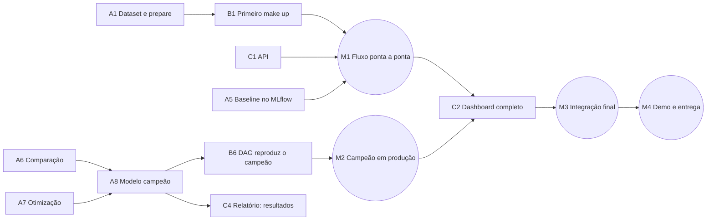

# Plano de implementação — FraudaZero

Guia para os agentes (Claude Code) e para o grupo. Prazo: **2 semanas (10 dias úteis, D1–D10)**. Leia antes `CLAUDE.md` (regras, stack, contratos) e `README.md`.

## 0. Como usar este plano (leia primeiro, agentes)

1. **Descubra sua frente** (A, B ou C) com a pessoa que está te usando. Trabalhe só nas pastas dela (tabela da seção 2) e só nas tarefas dela.
2. **Fluxo de cada tarefa:** leia a tarefa → diga em 3–5 linhas o que vai fazer → implemente o mínimo que atende o "Feito quando" → rode e comprove → marque `- [x]` na sua seção deste arquivo → commit pequeno → PR.
3. **Simples primeiro.** Se a tarefa pode ser cumprida em 20 linhas, não escreva 200. Sem Kubernetes, Kafka, MinIO, autenticação, CI complexo, feature store, serviços extras ou abstrações "para o futuro".
4. **Contratos são sagrados** (MQTT, API, tabela `transactions`, `FEATURES`). Precisa mudar? Pare, proponha a mudança à pessoa e avise as outras frentes no PR.
5. **Docs atuais:** use o MCP Context7 para Airflow **2.10**, MLflow 2.x, Streamlit, FastAPI e scikit-learn 1.6.
6. **Nunca invente números.** Toda métrica vem de uma execução real registrada no MLflow.
7. **Edite apenas a sua seção** deste arquivo (marcar checkboxes), para não gerar conflito de merge.
8. Em dúvida entre duas opções, escolha a mais simples e anote a decisão e o motivo no PR: o relatório pede "justificativa das decisões técnicas".

## 1. Ponto de partida (o que o esqueleto já tem)

| Item | Estado |
|---|---|
| Docker Compose com 8 serviços, Makefile, `.env.example`, imagens | Pronto, **nunca executado de ponta a ponta** (B1 valida) |
| `src/train.py`: `ingest`, `prepare`, `baseline` (regressão logística + MLflow + alias `champion`) | Funcional |
| `src/train.py`: `compare`, `tune` | `TODO` (frente A) |
| Simulador, subscriber, API (`/health`, `/predict`, `/reload`), DAG `fraudazero_pipeline`, dashboard básico | Primeira versão funcional, a evoluir |
| Notebooks de EDA e experimentos | Não existem (frente A) |
| Relatório SBC | Não existe; skill `relatorio-sbc` pronta (frente C) |
| Template SBC | Precisa ser copiado para `reports/` (frente C) |

## 2. Frentes, donos e dependências

| Frente | Escopo | Pastas | Pesa na nota |
|---|---|---|---|
| **A — Dados e ML** | EDA, validação, modelos, otimização, MLflow | `src/`, `notebooks/` | Análise de Dados 15% + Modelagem e Validação 30% |
| **B — Infra e MLOps** | Compose, simulador, MQTT, Postgres, Airflow, MLflow, integração | `embedded/`, `subscriber/`, `dags/`, `docker/`, `docker-compose.yml`, `Dockerfile`, `Makefile`, `tests/` | MLOps 25% |
| **C — API, dashboard e relatório** | API, dashboard, relatório SBC, README, site, apresentação | `api/`, `app/`, `reports/`, `README.md` | MLOps (parte) + Comunicação 20% |

Sugestão de equipe: a frente A deve ter mais gente, porque é a que mais vale nota (45%).

## 3. Marcos

| Marco | Quando | Critério de pronto |
|---|---|---|
| **M0 Setup** | D1 | Todos rodaram o prompt de setup ou deram `git clone`; dataset em `data/raw/`; `make check` ok |
| **M1 Fluxo ponta a ponta** | fim do D3 | `make up` em máquina limpa: simulador → MQTT → subscriber → API (baseline) → Postgres → dashboard mostrando transações e alertas |
| **M2 Campeão em produção** | fim do D7 | Melhor modelo registrado com alias `champion`; a DAG o reproduz e a API o serve |
| **M3 Integração final** | fim do D8 | Dashboard completo, todos os requisitos da seção 7 com evidência, relatório com rascunho completo |
| **M4 Entrega** | D9–D10 | Código congelado no D9; clone limpo testado por alguém que não escreveu o código; relatório SBC final; demo ensaiada |

Cronograma por dia (referência; ajustem conforme o andamento):

| Dia | A — Dados e ML | B — Infra e MLOps | C — API, dashboard, relatório |
|---|---|---|---|
| D1 | A1 | B1 | C0 (template SBC em `reports/`) |
| D2 | A2, A3 | B2, B3, B4 | C1 |
| D3 | A5 | B7 (parcial), fechar M1 | C1, esqueleto do relatório |
| D4–D5 | A4, A6 | B5, B6 (rascunho) | C2 (primeira versão) |
| D6–D7 | A7, A8, A9 | B6, B8 | C2, C3 |
| D8 | A10 | B9, B10 | C2 final, C4 |
| D9 | correções | B11, clone limpo | C4 final, C5 |
| D10 | ensaio | ensaio | C6, C7 |

## 4. Tarefas

### Frente A — Dados e ML

- [ ] **A1. Dataset e `prepare`.** Baixar o dataset (`data/README.md`) para `data/raw/creditcard.csv`. Rodar `python -m src.train prepare` e conferir `train.csv` (primeiros 80% por `Time`) e `stream.csv`.
  *Feito quando:* os dois arquivos existem, contam as linhas esperadas e a proporção de fraudes de cada um está anotada (será usada na EDA e no relatório).
- [ ] **A2. EDA** em `notebooks/01_eda.ipynb`, sobre `train.csv`. Estatísticas descritivas, nulos, duplicados e **mínimo de 5 visualizações, cada uma com interpretação escrita** em markdown: (1) distribuição das classes; (2) `Amount` por classe em escala log; (3) fraudes ao longo de `Time`; (4) correlação das variáveis com `Class`; (5) projeção 2D (PCA ou t-SNE em subamostra) das classes. Extras bem-vindos: distribuição dos scores das `V` mais discriminantes.
  *Feito quando:* o notebook roda do início ao fim, sem saídas commitadas (`nbstripout`), com a interpretação de cada gráfico.
- [ ] **A3. Tratamento de dados.** Decidir e **justificar** por escrito: escalonamento (`Time` e `Amount`; as `V` já vêm de PCA), duplicados, outliers de `Amount` (não remover fraudes), ausentes (a base não tem; registrar a checagem). Implementar dentro do `Pipeline` do modelo (nunca fora, para evitar vazamento).
  *Feito quando:* a seção "Tratamento" do notebook lista cada decisão com o motivo.
- [ ] **A4. Estratégia de validação** (módulo `src/validation.py` ou funções no notebook, o que for mais simples). Holdout temporal (já usado no baseline) + `StratifiedKFold` (k=5) com `Pipeline` (SMOTE/`class_weight` só nos folds de treino). Discutir a diferença: k-fold estratificado ignora o tempo, então compare com o holdout temporal. Leave-One-Out: justificar por que não se aplica (~285 mil linhas).
  *Feito quando:* existe função reutilizável que devolve métricas por fold (média e desvio) e o texto de justificativa está no notebook.
- [ ] **A5. Baseline registrado.** Rodar `python -m src.train baseline` e conferir no MLflow o experimento `baseline` (parâmetros, métricas, modelo, alias `champion`). Adicionar como artefatos a matriz de confusão e a curva PR.
  *Feito quando:* o run aparece no MLflow com PR-AUC, recall, precisão e F1 e a API consegue carregá-lo.
- [ ] **A6. Comparação de modelos** (`compare` em `src/train.py` e notebook `02_experimentos.ipynb`). KNN (em subamostra, via undersampling da classe majoritária, por custo), Árvore de Decisão, Random Forest, AdaBoost e MLP, todos em `Pipeline` com tratamento do desbalanceamento, avaliados com o A4. Experimento `comparacao` no MLflow, um run por modelo, com parâmetros, métricas (média e desvio entre folds), tempo de treino e artefatos (matriz de confusão, curva PR). Dica: rodar os experimentos pesados no notebook/local; o Airflow não precisa refazer a comparação.
  *Feito quando:* tabela comparativa pronta, com visualizações e **análise crítica** (qual modelo, por quê, trade-offs de custo e recall).
- [ ] **A7. Otimização de hiperparâmetros** (`tune`). Optuna (ou Random Search) no(s) melhor(es) modelo(s) da A6, objetivo PR-AUC, com espaço de busca documentado, número de trials limitado ao tempo disponível. Experimento `otimizacao` no MLflow.
  *Feito quando:* estratégia, espaço de busca, melhores parâmetros e ganho sobre a A6 documentados.
- [ ] **A8. Modelo campeão e limiar.** Escolher o campeão (critério explícito: PR-AUC e recall em um nível mínimo de precisão). Escolher o limiar na curva PR e informar ao grupo o valor para `FRAUD_THRESHOLD`. Registrar o modelo e mover o alias `champion`. Criar o comando `python -m src.train final`, que **retreina o campeão com os melhores parâmetros** (guardados em `src/best_params.json`), para a DAG conseguir reproduzi-lo.
  *Feito quando:* `models:/fraudazero@champion` aponta para o campeão e `final` o reproduz com métricas equivalentes.
- [ ] **A9. Diagnóstico.** Overfitting/underfitting (métricas de treino vs. validação, curva de aprendizado), estabilidade entre folds e generalização no holdout temporal.
  *Feito quando:* gráficos e parágrafo de interpretação prontos para o relatório.
- [ ] **A10. Entregar insumos ao relatório.** Tabelas e figuras exportadas em `reports/figs/` (PNG ou PDF) e um arquivo `reports/resultados.md` com os números finais e o run do MLflow de onde cada um saiu.

### Frente B — Infra e MLOps

- [ ] **B1. Primeiro `make up` real.** Subir a stack com o dataset e corrigir o que quebrar (dependências, portas, permissões, ordem de inicialização). Esta tarefa existe porque o esqueleto nunca foi executado de ponta a ponta.
  *Feito quando:* os 8 serviços ficam de pé, `make logs` não mostra erro recorrente e a DAG executa as 4 tarefas com sucesso.
- [ ] **B2. Simulador (`embedded/`).** Taxa configurável (`SIM_INTERVAL_S`), reconexão ao broker, loop do fluxo. Opcional (se houver tempo): modo "rajada" para demonstrar carga.
  *Feito quando:* publica de forma estável por 10+ minutos; mensagens seguem o contrato.
- [ ] **B3. Subscriber.** Persistência idempotente (`ON CONFLICT`), reconexão ao broker e ao banco, tolerância a falha da API (grava `score` nulo e segue).
  *Feito quando:* derrubar e subir a API/banco/broker não derruba o subscriber nem perde mensagens por muito tempo.
- [ ] **B4. Banco.** Índice em `received_at`, checagem do schema; garantir que o dashboard consegue ler 5 mil linhas rapidamente.
- [ ] **B5. DAG (`dags/`).** Cobrir "ingestão, preparação e disponibilização dos dados para treino" de forma clara: `ingest` valida os dados e (opcional, se der tempo) incorpora ao treino as transações rotuladas do Postgres; `prepare`; treino; `reload_api`. `retries`, `schedule` e logs legíveis.
  *Feito quando:* a DAG roda sozinha na primeira subida e pode ser disparada com `make train`.
- [ ] **B6. DAG reproduz o campeão.** Trocar a tarefa `baseline` por `final` (depende da A8). Manter `baseline` como tarefa opcional ou removê-la, o que for mais simples.
  *Feito quando:* após `make train`, a API serve o campeão e `/health` indica `model_loaded: true`.
- [ ] **B7. Integração treino → API.** Garantir `reload_api` funcionando e mesma versão de scikit-learn nas duas imagens.
- [ ] **B8. MLflow.** Servidor estável com artefatos em `mlruns/`, experimentos `baseline`, `comparacao`, `otimizacao` visíveis e modelo registrado.
- [ ] **B9. Observabilidade de runtime** (insumo do dashboard): garantir que o banco guarda `latency_ms` e `received_at`; opcional, expor a idade da última mensagem recebida.
- [ ] **B10. Smoke test.** `tests/test_smoke.py` cobre `/health` e `/predict`; adicionar um passo que confirma que chegam linhas novas em `transactions`.
- [ ] **B11. Reprodutibilidade.** Congelar versões (`pip freeze` do ambiente que funcionou), testar `git clone` limpo + `make up` em outra máquina (de preferência Windows/WSL e Linux/macOS) e ajustar o README.
  *Feito quando:* alguém que não escreveu o código sobe tudo seguindo só o README.

### Frente C — API, dashboard e relatório

- [ ] **C0. Template SBC** copiado para `reports/` (arquivos enviados pelo professor) e compilando em branco. Sem o template não há relatório válido.
- [ ] **C1. API.** Validar entradas (422 para features ausentes), mensagens de erro claras, `/health` com `model_loaded`. Proposta de melhoria (exige acordo, é mudança de contrato): devolver `model_version` em `/predict` para o dashboard mostrar qual modelo respondeu.
  *Feito quando:* `/docs` funciona, erros são tratados e há teste manual com payload real do simulador.
- [ ] **C2. Dashboard (`app/dashboard.py`).** Indicadores: total de transações, alertas, precisão e recall ao vivo, latência, vazão por minuto, distribuição dos scores, matriz de confusão ao vivo, últimos alertas. Interatividade: slider de limiar para ver o efeito em precisão/recall e filtro de janela de tempo. Seção "Modelo": métricas do campeão vindas do MLflow.
  *Feito quando:* atualiza sozinho, não quebra com banco vazio e cobre os itens exigidos: dados da infraestrutura, indicadores, métricas, previsões e monitoramento em tempo de execução.
- [ ] **C3. Monitoramento em tempo de execução.** Painel de saúde: API/modelo, idade da última transação, taxa de falhas de pontuação (`score` nulo).
- [ ] **C4. Relatório SBC** (use a skill `relatorio-sbc`). Seções: Resumo, Introdução, Dados e EDA, Metodologia, Modelagem e resultados, Arquitetura MLOps, Limitações, Conclusão, Referências. Números só de `reports/resultados.md`/MLflow. Escrever o esqueleto no D3 e preencher conforme os resultados chegam.
  *Feito quando:* PDF no template SBC, sem `TODO`, todas as figuras interpretadas.
- [ ] **C5. README final e site.** Nomes e usuários do GitHub, nome da solução, instruções de execução (validadas na B11), descrição e link do Google Sites. Site com problema, arquitetura, resultados e vídeo/print da demo.
- [ ] **C6. Roteiro da apresentação** (seção 8) e slides curtos, se o professor exigir.
- [ ] **C7. Ensaio** da demo completa, com cronômetro, incluindo plano B (gravação em vídeo) caso algo falhe.

## 5. Pontos de sincronização

| Quando | O que precisa estar combinado | Quem avisa quem |
|---|---|---|
| D1 | Contratos (MQTT, API, tabela, `FEATURES`) lidos por todos; donos de pasta | todos |
| D3 | Baseline no MLflow e API servindo-o (M1) | A → B, C |
| D6 | Formato do `best_params.json` e do comando `final` | A → B |
| D7 | Limiar escolhido (`FRAUD_THRESHOLD`) e métricas do campeão | A → B, C |
| D9 | **Congelamento do código.** Depois disso, só correções de bug | todos |

## 6. Regras de qualidade

- Branches curtas por frente (`dados/…`, `infra/…`, `api/…`), PR pequeno, revisado por um colega de outra frente.
- Notebooks sem saída (`nbstripout`); figuras finais exportadas em `reports/figs/`.
- Sem segredos no repositório; configuração só por variáveis de ambiente.
- Antes de abrir PR: `ruff format .`, `make check` e, se tocou em serviços, `make up` e olhar `make logs`.

## 7. Rastreabilidade com a especificação

| Requisito da especificação | Onde fica | Tarefas | Evidência |
|---|---|---|---|
| Leitura e EDA (notebook, estatísticas, tratamento justificado) | `notebooks/01_eda.ipynb` | A1–A3 | Notebook executável |
| ≥ 5 visualizações com interpretação | `notebooks/01_eda.ipynb` | A2 | Gráficos + texto |
| Holdout, k-fold, estabilidade, over/underfitting, LOO justificado | `src/`, notebook | A4, A9 | Tabelas por fold, curvas |
| Otimização de hiperparâmetros | `src/train.py` (`tune`) | A7 | Experimento `otimizacao` |
| Baseline + comparação (KNN, Árvore, RF, AdaBoost, MLP) | `src/train.py` (`compare`) | A5, A6 | Experimentos `baseline` e `comparacao` |
| MLflow (parâmetros, métricas, artefatos, modelo, múltiplos experimentos) | serviço `mlflow` | A5–A8, B8 | UI do MLflow |
| Sistema embarcado simulado + MQTT + persistência | `embedded/`, `subscriber/` | B2–B4 | Dados chegando em `transactions` |
| Pipeline no Airflow (ingestão, preparação, disponibilização) | `dags/` | B5, B6 | DAG verde |
| Modelo integrado ao pipeline + inferência via API | `api/`, `subscriber/` | B7, C1 | `/predict` e alertas no dashboard |
| Dashboard interativo e monitoramento | `app/` | C2, C3 | Demo |
| Docker Compose, um comando | raiz | B1, B11 | Clone limpo + `make up` |
| Relatório no template SBC | `reports/` | C0, C4 | PDF no template |
| README (nomes, GitHub, nome, instruções, Google Sites) | `README.md` | C5 | README completo |

## 8. Roteiro da demonstração (aprox. 10 min)

1. **Contexto (1 min):** problema, base de dados e arquitetura (diagrama do README).
2. **Subida (1 min):** `docker compose ps` com todos os serviços de pé (a stack já deve estar iniciada antes da apresentação).
3. **Dados chegando (2 min):** simulador publicando; mostrar transações no Postgres e o fluxo MQTT.
4. **Airflow (1 min):** DAG verde; disparar `make train` ao vivo se o tempo permitir.
5. **MLflow (2 min):** experimentos `baseline`, `comparacao` e `otimizacao`, comparação de runs, modelo `champion`.
6. **API e dashboard (2 min):** `/predict` com um exemplo; dashboard com alertas, precisão/recall ao vivo, slider de limiar e painel de saúde.
7. **Decisões e limitações (1 min):** métricas escolhidas, split temporal, variáveis anonimizadas, simulação no lugar de hardware, o que faríamos a seguir.

## 9. Riscos e mitigação

| Risco | Mitigação |
|---|---|
| Stack pesada demais para os notebooks do grupo | Aumentar `SIM_INTERVAL_S`; fechar outros programas; testar em D1 (B1) |
| Dependências do Airflow conflitando | Treino em venv próprio (já configurado); não atualizar o Airflow |
| Modelo salvo não carrega na API | Mesma versão de scikit-learn nas duas imagens; `final` reproduz o campeão |
| Treino lento (KNN, RF, MLP em 228 mil linhas) | Subamostra para KNN; limitar trials do Optuna; experimentos pesados no notebook, não no Airflow |
| Vazamento de dados (SMOTE/escala antes do split) | Tudo dentro do `Pipeline`; revisão cruzada de PR na frente A |
| Template SBC só descoberto no fim | C0 no D1; relatório em esqueleto no D3 |
| Demo falhar ao vivo | Ensaio (C7), stack iniciada antes, vídeo de backup |
| Código só funciona na máquina de um colega | B11: clone limpo testado por quem não escreveu o código |

## 10. Definição de pronto

- [ ] `git clone` limpo + dataset em `data/raw/` + `make up` = sistema funcionando só com o README
- [ ] Todos os itens da seção 7 com evidência
- [ ] Relatório SBC final em `reports/`, sem `TODO`
- [ ] Demo ensaiada (com vídeo de backup)
- [ ] README completo 