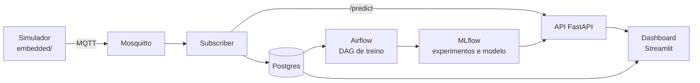

# FraudaZero

**Detecção de fraude em transações de cartão em tempo real**, com pipeline completo de MLOps: sistema embarcado simulado → MQTT → Postgres → Airflow → MLflow → API de inferência → dashboard, tudo conteinerizado.

Projeto da disciplina Aprendizado de Máquina (CESAR School, 2026.6, unidade 2a).

## Equipe

| Nome e sobrenome | GitHub |
|---|---|
| Irvin Amilcar | [@usuario](https://github.com/usuario) |
| Julia Torres de Barros | [@usuario](https://github.com/JuliaTBarros) |
| Matheus Martins Veríssimo | [@usuario](https://github.com/usuario) |
| Vinícius José Matias marques | [@usuario](https://github.com/usuario) |

## Descrição

O FraudaZero recebe transações por MQTT (publicadas por um simulador que reproduz o fluxo de um sistema embarcado), pontua cada uma com um modelo de aprendizado de máquina servido por API e exibe indicadores, previsões e métricas em um dashboard em tempo real. O Airflow orquestra a preparação dos dados e o treino, e o MLflow registra experimentos e versiona o modelo.

- **Dados:** [Credit Card Fraud Detection](https://www.kaggle.com/datasets/mlg-ulb/creditcardfraud) (ULB/Kaggle): ~285 mil transações, 0,17% de fraudes. Os primeiros 80% (por `Time`) formam o *bootstrap dataset*; os últimos 20% viram o fluxo simulado.
- **Modelos:** baseline (regressão logística) e comparação entre KNN, Árvore de Decisão, Random Forest, AdaBoost e MLP, com validação temporal e estratificada e otimização de hiperparâmetros.
- **Site do projeto:** _inserir link do Google Sites_
- **Relatório (formato SBC):** [`reports/`](reports/)

## Arquitetura



## Como executar

**Pré-requisitos:** Docker com Docker Compose v2 (Windows: Docker Desktop com WSL2), ~8 GB de RAM livres e `make` (no Windows, use o WSL ou rode os comandos `docker compose` equivalentes).

1. Clone o repositório:
   ```bash
   git clone <url-do-repositorio> && cd fraudazero
   ```
2. Baixe o dataset do Kaggle e salve como `data/raw/creditcard.csv` (o arquivo não é versionado). O download público abaixo não precisa de login (~70 MB):

   **macOS / Linux**
   ```bash
   curl -L -o data/raw/creditcard.zip https://www.kaggle.com/api/v1/datasets/download/mlg-ulb/creditcardfraud
   unzip -o data/raw/creditcard.zip -d data/raw && rm data/raw/creditcard.zip
   ```

   **Windows (PowerShell)**
   ```powershell
   curl.exe -L -o data\raw\creditcard.zip https://www.kaggle.com/api/v1/datasets/download/mlg-ulb/creditcardfraud
   Expand-Archive -Force data\raw\creditcard.zip data\raw; Remove-Item data\raw\creditcard.zip
   ```

   Alternativa com a CLI do Kaggle (precisa de `~/.kaggle/kaggle.json`): `kaggle datasets download -d mlg-ulb/creditcardfraud -p data/raw --unzip`
3. Suba toda a solução com um único comando:
   ```bash
   make up        # ou: docker compose up --build -d
   ```
   No Windows sem `make` (PowerShell ou CMD), use direto `docker compose up --build -d`. Os demais alvos do `Makefile` são só atalhos para comandos `docker compose`.
4. Aguarde ~2–3 minutos. A DAG `fraudazero_pipeline` roda sozinha na primeira inicialização (prepara os dados, treina o baseline e registra o modelo). Para disparar de novo: `make train`.

| Serviço | Endereço |
|---|---|
| Dashboard | http://localhost:8501 |
| API (docs) | http://localhost:8000/docs |
| Airflow | http://localhost:8080 (usuário e senha: `admin`) |
| MLflow | http://localhost:5001 |
| Postgres | `localhost:5433` (usuário e senha: `fraudazero`) |
| Broker MQTT | `localhost:1883` |

Outros comandos: `make logs`, `make down`, `make reset` (apaga os volumes e recomeça), `make test`.

## Ambiente de desenvolvimento

Os serviços rodam no Docker. Localmente, cada integrante só precisa de Python 3.11 e de um `.venv` com as ferramentas de desenvolvimento (`ruff`, `pytest`, `nbstripout`). O hook do Claude Code formata os `.py` usando o `ruff` desse `.venv`.

### macOS

```bash
brew install python@3.11
python3.11 -m venv .venv
source .venv/bin/activate
pip install ruff pytest nbstripout requests
nbstripout --install
```

No macOS com [Colima](https://github.com/abiosoft/colima) em vez do Docker Desktop, dê memória suficiente à VM: `colima start --memory 6 --cpu 4`.

### Linux (Debian/Ubuntu)

```bash
sudo apt install python3.11 python3.11-venv
python3.11 -m venv .venv
source .venv/bin/activate
pip install ruff pytest nbstripout requests
nbstripout --install
sudo chown -R 50000:0 data mlruns   # permite que o Airflow escreva em data/ e mlruns/
```

### Windows (PowerShell)

```powershell
winget install Python.Python.3.11
py -3.11 -m venv .venv
.venv\Scripts\Activate.ps1          # se bloquear: Set-ExecutionPolicy -Scope CurrentUser RemoteSigned
pip install ruff pytest nbstripout requests
nbstripout --install
```

No Windows, use o Docker Desktop com o backend WSL2 e dê a ele pelo menos 6 GB de RAM (Settings → Resources, ou `.wslconfig`).

`nbstripout --install` precisa ser rodado **em cada clone**, porque ele grava a configuração em `.git/config`, que não é versionado.

## Estrutura do repositório

```
├── data/            # dados (raw, processed, stream) — não versionados
├── notebooks/       # EDA e experimentos
├── src/             # código de treino (CLI) e configuração compartilhada
├── embedded/        # simulador do sistema embarcado
├── subscriber/      # consumidor MQTT que pontua e persiste
├── dags/            # DAG do Apache Airflow
├── api/             # API de inferência
├── app/             # dashboard
├── mlruns/          # artefatos do MLflow
├── docker/          # Dockerfile do Airflow, init do Postgres, config do Mosquitto
├── reports/         # relatório em PDF (formato SBC)
├── tests/           # smoke test
├── Dockerfile
├── docker-compose.yml
├── requirements.txt
└── README.md
```

## Problemas comuns

- **Porta em uso:** altere o mapeamento de portas no `docker-compose.yml` (ex.: Postgres local ocupando a 5432 é a razão de usarmos 5433).
- **Dashboard vazio:** confira se o dataset está em `data/raw/creditcard.csv` e se a DAG rodou com sucesso no Airflow; o simulador só publica depois que `data/stream/stream.csv` existe.
- **API responde 503:** o modelo ainda não foi registrado; aguarde a DAG ou rode `make train`.
- **Linux, erro de permissão em `data/`:** `sudo chown -R 50000:0 data mlruns`.
- **Recomeçar do zero:** `make reset && make up`.
